# Deploy na AWS | API Biblioteca Online em EC2 + Nginx + MongoDB Atlas

Laboratório prático de **deploy de uma API REST em nuvem**: a [API Biblioteca Online](../README.md) (Node.js, Express e MongoDB) foi publicada em uma instância **Amazon EC2**, atrás do **Nginx** como proxy reverso, gerenciada pelo **systemd** e conectada a um banco no **MongoDB Atlas**.

O foco não está no código da API, e sim no processo de **provisionamento, configuração de rede, segurança, execução como serviço e publicação**. É a continuação do [laboratório anterior](https://github.com/gondaline/aws-ec2-apache-lab), que publicou uma página estática com Apache.

A instância **foi encerrada ao final do laboratório** para não gerar custo. As provas da publicação estão na seção [Evidências](#evidências).

## Tecnologias utilizadas

| Tecnologia | Papel no laboratório |
| --- | --- |
| Amazon EC2 (`t3.micro`) | Máquina virtual que executa a API |
| Amazon Linux 2023 | Sistema operacional da instância |
| AWS Security Groups | Firewall de entrada e saída da instância |
| Nginx 1.30 | Proxy reverso: recebe na porta 80 e repassa para a API |
| Node.js 22 (via nvm) | Runtime da API |
| systemd | Mantém a API em execução, reinicia em caso de falha e inicia com o sistema |
| MongoDB Atlas (AWS `sa-east-1`) | Banco de dados gerenciado |
| OpenSSH | Administração remota da instância |
| Postman | Testes das rotas pela internet |

**Região da instância:** `us-east-2` (Ohio).

## Arquitetura

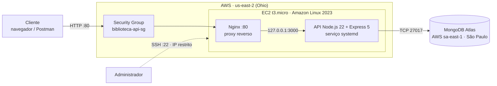

1. O cliente acessa o **IPv4 público da instância** na porta 80.
2. O **Security Group** permite a entrada na porta 80. A porta 3000, da API, **não é exposta**.
3. O **Nginx** recebe a requisição e repassa para a API em `127.0.0.1:3000`, dentro da própria máquina.
4. A **API** consulta o **MongoDB Atlas**, que só aceita conexões de IPs autorizados.

O SSH serve apenas para administrar a máquina e **não participa do atendimento das requisições**.

## Decisões de segurança

- **Porta da API fechada para a internet:** só as portas 80 (HTTP) e 22 (SSH) aceitam entrada. A API, na porta 3000, é acessível apenas pelo Nginx, dentro da instância.
- **SSH restrito:** a porta 22 aceita conexões somente do IP do administrador (`/32`), com uma chave dedicada a este laboratório.
- **Saída restrita ao necessário:** a instância só sai pelas portas 80 e 443 (pacotes do sistema, Node.js e GitHub) e 27017 (MongoDB Atlas), em vez de liberar todo o tráfego, que é o padrão da AWS.
- **Banco fechado para o mundo:** a lista de acesso do Atlas, que antes tinha `0.0.0.0/0`, passou a aceitar apenas o IP da instância e o da máquina de desenvolvimento.
- **API sem privilégios de administrador:** o serviço roda com o usuário `ec2-user`, e não como `root`.
- **Instância sem perfil IAM:** a API não usa outros serviços da AWS, então a instância não recebeu nenhuma permissão na conta (privilégio mínimo).
- **Segredos fora do repositório:** o `.env` com a string de conexão foi criado diretamente no servidor, com permissão `600` (leitura apenas pelo dono).
- **Versão do Nginx oculta:** `server_tokens off` evita expor a versão do servidor nas respostas.
- **Conta protegida:** login com MFA e alerta de orçamento de US$ 5 no AWS Budgets.

## Ajuste no código antes do deploy

A conexão com o banco era iniciada sem `await`. Se ela falhasse, o erro aparecia de forma confusa e a API podia começar a responder antes do banco estar pronto. Em [`src/config/dbConnect.js`](../src/config/dbConnect.js), a conexão passou a ser aguardada e a falhar com uma mensagem clara:

```js
async function connectDatabase() {
    try {
        await mongoose.connect(process.env.DB_CONNECTION_STRING);
        console.log("Conexão com o banco feita com sucesso!");
    } catch (error) {
        console.error("Não foi possível conectar ao banco:", error.message);
        process.exit(1);
    }

    return mongoose.connection;
}
```

Com isso, a API só aceita requisições depois de conectar ao banco. Se a conexão falhar, ela encerra com código `1`, o que permite ao systemd reiniciá-la automaticamente (`Restart=on-failure`).

## Configuração e publicação

### 1. Rede e acesso

Foi criado um par de chaves SSH exclusivo para o laboratório e o Security Group `biblioteca-api-sg`:

**Regras de entrada**

| Serviço | Porta | Origem | Motivo |
| --- | ---: | --- | --- |
| HTTP | `80/TCP` | `0.0.0.0/0` | Acesso público à API, pelo Nginx |
| SSH | `22/TCP` | `IP_DO_ADMINISTRADOR/32` | Administração restrita a um único IP |

**Regras de saída**

| Serviço | Porta | Destino | Motivo |
| --- | ---: | --- | --- |
| HTTP | `80/TCP` | `0.0.0.0/0` | Repositórios de pacotes |
| HTTPS | `443/TCP` | `0.0.0.0/0` | Pacotes do sistema, Node.js e GitHub |
| MongoDB | `27017/TCP` | `0.0.0.0/0` | Conexão com o MongoDB Atlas |

O destino da porta 27017 é `0.0.0.0/0` porque os IPs dos servidores do Atlas não são fixos. A restrição é feita pela porta.

### 2. Instância EC2

- **AMI:** Amazon Linux 2023 (x86_64)
- **Tipo:** `t3.micro` (2 vCPUs, 1 GiB de memória)
- **Armazenamento:** 8 GiB `gp3`
- **IP público:** atribuído automaticamente (sem IP elástico)
- **Perfil IAM:** nenhum

Acesso por SSH:

```bash
ssh -i "caminho/para/chave.pem" ec2-user@IP_PUBLICO_DA_INSTANCIA
```

### 3. Preparação do servidor

```bash
sudo dnf update -y
sudo dnf install -y git

curl -o- https://raw.githubusercontent.com/nvm-sh/nvm/v0.40.3/install.sh | bash
source ~/.bashrc
nvm install 22
```

O Node.js foi instalado pelo nvm para usar a **mesma versão do ambiente de desenvolvimento** (Node 22), já que o projeto exige Node 20.19 ou superior.

### 4. Aplicação

```bash
cd ~
git clone https://github.com/gondaline/biblioteca-online.git
cd biblioteca-online
npm ci --omit=dev
```

- `npm ci` instala exatamente as versões do `package-lock.json`.
- `--omit=dev` deixa de fora as ferramentas de desenvolvimento (ESLint, Prettier, nodemon), que não são necessárias em produção.

O `.env` foi criado no servidor e protegido:

```bash
nano .env      # DB_CONNECTION_STRING=... e PORT=3000
chmod 600 .env
```

### 5. Liberação no MongoDB Atlas

Na **IP Access List** do Atlas, o IP público da instância foi adicionado como `/32`. O teste manual confirmou a conexão:

```bash
node server.js
# Conexão com o banco feita com sucesso!
# Servidor rodando na porta 3000
```

### 6. Serviço no systemd

Arquivo `/etc/systemd/system/biblioteca-api.service`:

```ini
[Unit]
Description=API Biblioteca Online (Node.js)
After=network-online.target
Wants=network-online.target

[Service]
User=ec2-user
WorkingDirectory=/home/ec2-user/biblioteca-online
ExecStart=/home/ec2-user/.nvm/versions/node/v22.23.4/bin/node server.js
Environment=NODE_ENV=production
Restart=on-failure
RestartSec=5

[Install]
WantedBy=multi-user.target
```

| Diretiva | Função |
| --- | --- |
| `After` / `Wants=network-online.target` | Inicia a API só depois que a rede estiver disponível |
| `User=ec2-user` | Executa sem privilégios de administrador |
| `WorkingDirectory` | Pasta do projeto, de onde o `dotenv` lê o `.env` |
| `ExecStart` | Caminho completo do Node, porque o systemd não carrega o ambiente do nvm |
| `Restart=on-failure` | Reinicia a API se ela encerrar com erro |
| `WantedBy=multi-user.target` | Permite iniciar a API junto com o sistema |

```bash
sudo systemctl daemon-reload
sudo systemctl enable --now biblioteca-api
sudo systemctl status biblioteca-api --no-pager
sudo journalctl -u biblioteca-api --no-pager -n 20
```

### 7. Nginx como proxy reverso

```bash
sudo dnf install -y nginx
sudo systemctl enable --now nginx
```

Arquivo `/etc/nginx/conf.d/biblioteca-api.conf`:

```nginx
server_names_hash_bucket_size 128;

server {
    listen 80;
    server_name IP_PUBLICO_DA_INSTANCIA DNS_PUBLICO_DA_INSTANCIA;

    server_tokens off;

    location / {
        proxy_pass http://127.0.0.1:3000;
        proxy_set_header Host $host;
        proxy_set_header X-Real-IP $remote_addr;
        proxy_set_header X-Forwarded-For $proxy_add_x_forwarded_for;
        proxy_set_header X-Forwarded-Proto $scheme;
    }
}
```

```bash
sudo nginx -t
sudo systemctl reload nginx
```

O Nginx ocupa a porta 80 (que exige privilégio de administrador) e repassa as requisições para a API, que roda sem privilégios na porta 3000. Os cabeçalhos `X-Forwarded-*` preservam o IP real de quem fez a requisição.

### 8. Testes

De dentro da instância:

```bash
curl http://localhost:3000
curl http://localhost:3000/books
```

Pela internet, com o Postman:

| Método | Rota | Resultado |
| --- | --- | --- |
| `POST` | `/authors` | `201 Created` |
| `POST` | `/publishers` | `201 Created` |
| `POST` | `/books` | `201 Created`, com referências ao autor e à editora |
| `GET` | `/books` | `200 OK`, com autor e editora preenchidos pelo `populate` |

## Evidências

As capturas registram as etapas do laboratório. O IP do administrador foi ocultado.

### Instância EC2

Instância `t3.micro` em execução, com IP e DNS públicos, sem IP elástico e sem perfil IAM.

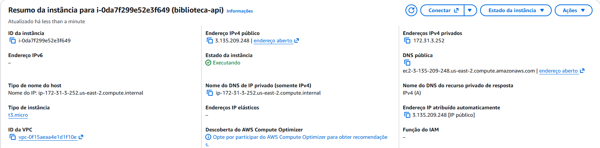

### Security Group: regras de entrada

HTTP liberado para acesso público e SSH restrito a um único IP. A porta 3000 não aparece, ou seja, está fechada.

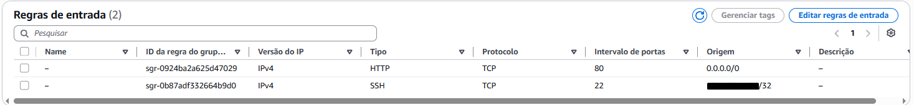

### Security Group: regras de saída

Saída restrita às portas 80, 443 e 27017.

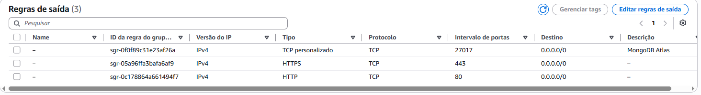

### Lista de acesso do MongoDB Atlas

O banco aceita conexões apenas da instância EC2 e da máquina de desenvolvimento.

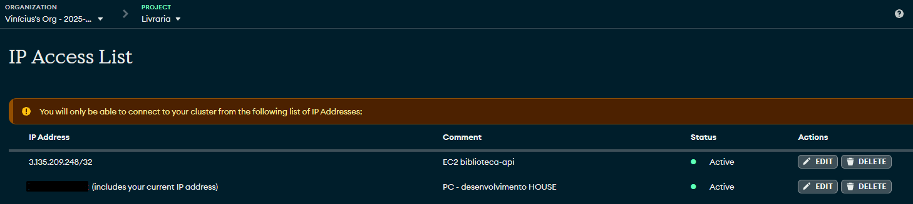

### API como serviço do systemd

Serviço `enabled` (inicia com o sistema) e `active (running)`.

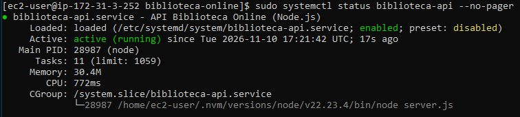

### Logs da API

O systemd inicia o serviço, a API conecta ao banco e só então passa a aceitar requisições.

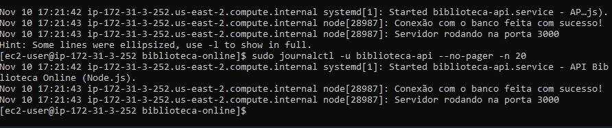

### API publicada

Rota principal acessada pelo navegador através do IP público da instância. O aviso **"Não seguro"** é esperado, porque o laboratório usa HTTP, sem certificado TLS.

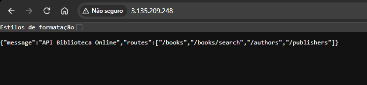

### Cadastro pela internet

`POST /authors` pelo Postman, com resposta `201 Created`.

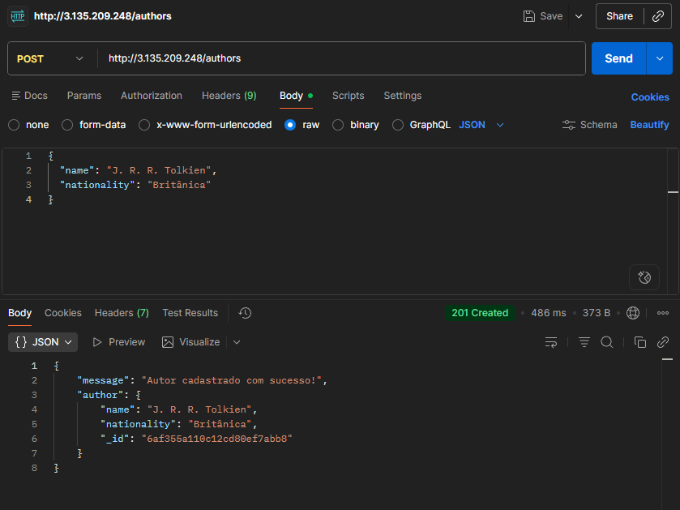

### Listagem com dados relacionados

`GET /books` devolvendo o livro com os nomes do autor e da editora, buscados no banco pelo `populate`.

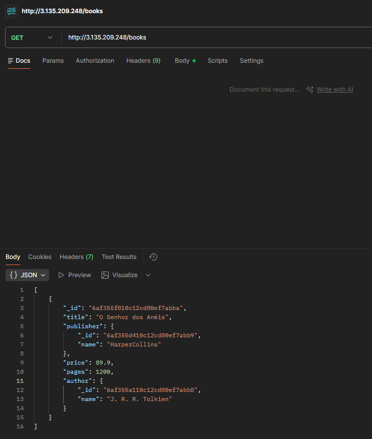

### Instância encerrada

Instância encerrada ao final do laboratório.

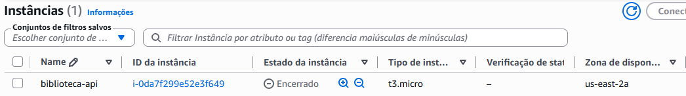

## Problemas encontrados e soluções

| Problema | Causa | Solução |
| --- | --- | --- |
| Erro de conexão com o Atlas no ambiente local | O IP residencial muda periodicamente, e a entrada antiga da lista não valia mais | Atualizar a IP Access List com o IP atual e remover os IPs antigos |
| Região São Paulo indisponível | O plano gratuito da conta restringe o projeto a `us-east-2` | Instância criada em Ohio (ver [Limitações e decisões](#limitações-e-decisões)) |
| SSH e HTTP com *timeout* | As regras foram cadastradas como **saída** em vez de **entrada**, então a entrada ficou vazia | Recriar as regras na seção de entrada. O diagnóstico veio do teste da porta 80: se nem ela, aberta para todos, respondia, o bloqueio não era só do IP |
| `dnf update` com `Curl error (28): Timeout` | A saída só permitia a porta 80, e os repositórios usam HTTPS | Liberar a saída na porta 443, mantendo a saída restrita |
| *Connection refused* na porta 80 | O Nginx foi instalado, mas não iniciado | `systemctl enable --now nginx`. *Recusado* indica que a requisição chegou à máquina mas nada escutava a porta; *timeout* indica bloqueio no caminho |
| `could not build server_names_hash` no `nginx -t` | O DNS público da EC2 é maior que o tamanho padrão da tabela de nomes do Nginx | `server_names_hash_bucket_size 128;` |

## Limitações e decisões

- **Aplicação e banco em regiões diferentes:** o plano gratuito restringe o projeto a `us-east-2` (Ohio), enquanto o banco está em `sa-east-1` (São Paulo). Cada consulta ao banco atravessa o continente. No Postman, o cadastro de um autor levou cerca de **486 ms** (cliente no Brasil → Ohio → São Paulo → retorno). Em produção, aplicação e banco ficariam na mesma região.
- **Sem HTTPS:** não foi configurado domínio nem certificado TLS. O tráfego é HTTP, aceitável apenas para dados de teste.
- **IP público dinâmico:** sem IP elástico, o endereço muda se a instância for parada e iniciada.
- **Disco sem criptografia:** o volume EBS foi criado sem criptografia, aceitável para um laboratório sem dados sensíveis.
- **Deploy manual:** a atualização da aplicação depende de acesso por SSH, sem pipeline automatizado.
- **Versão do Node fixada no serviço:** o `ExecStart` aponta para o caminho da versão instalada pelo nvm e precisa ser ajustado se a versão mudar.

### Melhorias futuras

- HTTPS com domínio próprio e certificado Let's Encrypt.
- CI/CD com GitHub Actions para deploy automático.
- Infraestrutura como código com Terraform.
- Aplicação e banco na mesma região.
- Usuário de banco dedicado para a API, com permissão apenas no banco da aplicação.
- Acesso administrativo pelo AWS Systems Manager, sem porta 22 aberta.
- Disco criptografado e logs centralizados no CloudWatch.

## Encerramento dos recursos e custo

Ao final do laboratório:

1. A instância EC2 foi **encerrada** (*terminated*), o que apaga a máquina e o disco.
2. O IP da instância foi **removido da lista do Atlas**. O IP volta para a AWS e pode ser atribuído a outro cliente, então a permissão não deve permanecer.
3. O Security Group e o par de chaves foram **excluídos**, e a chave privada foi apagada da máquina local.

Os dados cadastrados **continuam no Atlas**, porque o banco é independente da instância. Com aplicação e dados separados, a máquina pode ser descartada e recriada sem perda de informação.

O custo foi coberto pelos créditos do plano gratuito da AWS.
<!-- TODO: informar o valor consumido, conferido em "Status do plano gratuito". -->

## Aprendizados

Este laboratório ampliou o anterior (servidor web estático) para uma **aplicação com banco de dados**, e permitiu praticar:

- separar responsabilidades entre **proxy reverso, aplicação e banco**;
- executar uma aplicação Node.js como **serviço do systemd**, com reinício automático e inicialização com o sistema;
- configurar **firewall de entrada e de saída** pelo princípio do menor privilégio;
- controlar o acesso ao banco por **lista de IPs** em vez de deixá-lo aberto;
- diagnosticar problemas de rede pela diferença entre ***timeout*** e ***connection refused***;
- ler logs com `journalctl` e validar configurações com `nginx -t` antes de aplicá-las;
- **encerrar os recursos** e revogar as permissões associadas a eles ao final do uso.

---

**Autor:** [Vinícius Gondaline Silva](https://github.com/Gondaline)
**Finalidade:** laboratório de estudos em AWS, Linux e deploy de aplicações.
